

<a href="https://www.linkedin.com/in/sammy-nashed">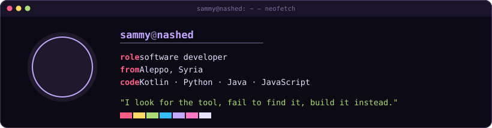</a>

 

 &nbsp;  &nbsp; 

  

 
 
<a href="https://github.com/SammyNashed/ratl"></a> <a href="https://github.com/SammyNashed/chess-2">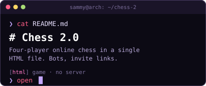</a>
 
<a href="https://github.com/SammyNashed/Emran">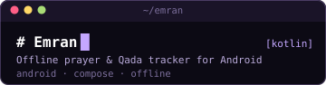</a> <a href="https://github.com/SammyNashed/yet-stories">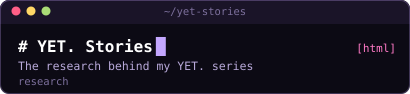</a>
 
<a href="https://github.com/SammyNashed/Trichyguard-AI"></a> <a href="https://github.com/SammyNashed/quiet-tab-linux">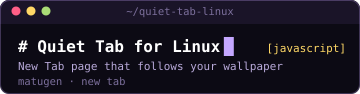</a>
 
<a href="https://github.com/SammyNashed/rota">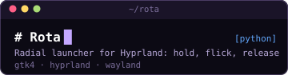</a> <a href="https://github.com/SammyNashed/quiet-tab-windows"></a>
 
<a href="https://github.com/SammyNashed/paradox">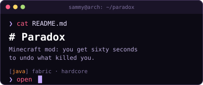</a> <a href="https://github.com/SammyNashed/whatsapp-matugen-theme"></a>
 
<a href="https://github.com/SammyNashed/refind-choose-your-fate"></a> <a href="https://github.com/SammyNashed/zen-pwa-automator"></a>
 

