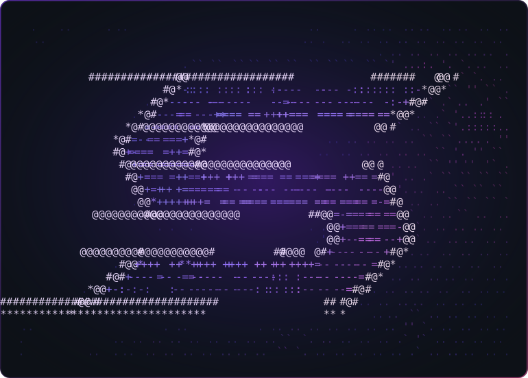

<table>
<tr>
<td width="44%" valign="top">

### Sammy &nbsp;`@SammyNashed`

**Software developer.** I pick the language and the platform
per problem, then ship the thing. 
Aleppo, Syria &nbsp;·&nbsp; UTC+03:00

<a href="#featured">Featured</a> &nbsp;·&nbsp;
<a href="#everything-ive-built">All projects</a> &nbsp;·&nbsp;
<a href="https://www.linkedin.com/in/sammy-nashed">LinkedIn</a> &nbsp;·&nbsp;
<a href="mailto:nashedsammy@gmail.com">Email</a>

</td>
<td width="56%" valign="top">

</td>
</tr>
</table>

---

### About

IT student. I started on Android in Kotlin, and that turned out to be the
starting point rather than the specialty — these days the work runs across
Linux desktop tooling, native GTK4 and Electron apps, on-device machine
learning, a Minecraft mod, and a bootloader theme. What stays constant is
that I'd rather finish something installable than leave a demo behind.

Most of what's here started as a problem I had myself, which is also why the
projects tend to be offline-first: no accounts, no telemetry, nothing that
needs a server to keep working.

I'm comfortable in the unglamorous parts — state modelling, persistence,
packaging, and getting a build to behave the same on someone else's machine.

 

### Featured

📌 The six pinned on my profile. Everything else is in the <a href="#everything-ive-built">full list</a> below.

<table>
<tr>
<td width="50%" valign="top">

#### [RATL](https://github.com/SammyNashed/ratl) &nbsp;`Kotlin · ONNX Runtime`

An on-device Quran recitation assessment engine, shipped as an SDK rather
than an app. Given a target passage and a recording, it returns a per-word
status with timings and a confidence score — no cloud inference, no API keys.
It abstains instead of guessing: where the evidence doesn't support a verdict,
it reports `UNCERTAIN` rather than accusing a reciter wrongly.

Submitted to Itqan's *Code Serves the Quran* campaign. &nbsp;<a href="https://github.com/SammyNashed/ratl/issues">10 open issues →</a>

</td>
<td width="50%" valign="top">

#### [Trichyguard](https://github.com/SammyNashed/Trichyguard-AI) &nbsp;`JavaScript · MediaPipe`

A hand-tracking guard against hair-pulling, built for a habit I have myself.
The webcam feed and the model both stay on the machine; when your hand lingers
near your hair, the screen locks, and it lifts once the hand is away. Runs in
the browser or as a native background app. Earlier versions had streaks, stats
and a journal — all of it got removed, because an app like this shouldn't ask
for attention.

<a href="https://sammynashed.github.io/Trichyguard-AI/">Try it in the browser →</a>

</td>
</tr>
<tr>
<td width="50%" valign="top">

#### [Rota](https://github.com/SammyNashed/rota) &nbsp;`Python · GTK4`

A radial launcher for Hyprland: hold the middle mouse button on the desktop,
flick toward what you want, release. A Wayland reimplementation of Rovyl,
built on layer-shell with a global evdev grab so the gesture works anywhere.

</td>
<td width="50%" valign="top">

#### [Paradox](https://github.com/SammyNashed/paradox) &nbsp;`Java · Fabric`

A hardcore Minecraft mod that suspends death. Instead of the world ending, you
get sixty seconds as a spirit to go back and undo whatever killed you. Fabric,
Minecraft 26.2.

</td>
</tr>
<tr>
<td width="50%" valign="top">

#### [Choose Your Fate](https://github.com/SammyNashed/refind-choose-your-fate) &nbsp;`rEFInd theme`

A boot menu that offers your operating systems as the red and the blue pill,
rendered in neofetch-style ASCII art. Generated, so it adapts to whatever
you actually have installed.

</td>
<td width="50%" valign="top">

#### [Emran](https://github.com/SammyNashed/Emran) &nbsp;`Kotlin · Jetpack Compose`

Where I started. An offline-first Islamic prayer and Qada tracker for Android
— glassmorphic UI, habit mechanics with recovery targets and milestone resets,
years of history kept local to the device. Shipped as a signed APK through
Releases.

</td>
</tr>
</table>

 

### Everything I've built

Every public project, grouped by what it's for. ▶ means you can try it in the browser right now.

| | Project | What it is | Stack |
|:-:|---|---|---|
| | **Quran & faith** | | |
| 📌 | [RATL](https://github.com/SammyNashed/ratl) | On-device Quran recitation checker, as an SDK for other apps | Kotlin · ONNX |
| 📌 | [Emran](https://github.com/SammyNashed/Emran) | Offline prayer and Qada tracker for Android | Kotlin · Compose |
| | **Wellbeing** | | |
| 📌 | [Trichyguard](https://github.com/SammyNashed/Trichyguard-AI) &nbsp;[▶](https://sammynashed.github.io/Trichyguard-AI/) | Hand-tracking guard against hair-pulling; nothing leaves your machine | JavaScript · MediaPipe |
| | **Linux desktop** | | |
| 📌 | [Rota](https://github.com/SammyNashed/rota) | Radial launcher for Hyprland: hold, flick, release | Python · GTK4 |
| 📌 | [Choose Your Fate](https://github.com/SammyNashed/refind-choose-your-fate) | rEFInd boot theme: your OSes as the red and blue pill | Python · rEFInd |
| | [Quiet Tab for Linux](https://github.com/SammyNashed/quiet-tab-linux) | Minimal New Tab page that follows your wallpaper and matugen colours | JavaScript |
| | [WhatsApp Matugen Theme](https://github.com/SammyNashed/whatsapp-matugen-theme) | Themes WhatsApp Web from your wallpaper palette | JavaScript · Extension |
| | **Windows & browsers** | | |
| | [Quiet Tab for Windows](https://github.com/SammyNashed/quiet-tab-windows) | The same quiet New Tab page, with Lively wallpaper support | JavaScript |
| | [Zen PWA Automator](https://github.com/SammyNashed/zen-pwa-automator) | Adds native PWA support to Zen Browser | PowerShell |
| | **Games & stories** | | |
| 📌 | [Paradox](https://github.com/SammyNashed/paradox) | Minecraft mod: sixty seconds as a spirit to undo your death | Java · Fabric |
| | [Chess 2.0](https://github.com/SammyNashed/chess-2) &nbsp;[▶](https://sammynashed.github.io/chess-2/) | Four-player online chess in one HTML file, with bots and invite links | HTML · JavaScript |
| | [YET. Stories](https://github.com/SammyNashed/yet-stories) &nbsp;[▶](https://sammynashed.github.io/yet-stories/) | The real research behind my *YET.* Instagram series | HTML |
| | **Forks** | | |
| | [awesome-hyprland](https://github.com/SammyNashed/awesome-hyprland) · [theme-store](https://github.com/SammyNashed/theme-store) | Upstream projects I have forked | |

<a href="https://github.com/SammyNashed?tab=repositories">Browse all repositories on GitHub →</a>

 

### Tech

 

